# F1 – Thêm môn học

Nguồn: PRD §2 F1. Phụ thuộc: –. Được dùng lại bởi: F4 (validation khi Sửa).

```mermaid
flowchart TD
    Start(["Bắt đầu"]) --> Input[/"Người dùng nhập Tên môn, Số tín chỉ, Điểm hệ 10"/]
    Input --> Submit{"Nhấn 'Thêm môn' hoặc Enter?"}
    Submit -->|Chưa| Input
    Submit -->|Có| Clear["Xoá các thông báo lỗi cũ dưới ô nhập"]
    Clear --> Normalize["Chuẩn hoá: trim Tên môn, đổi dấu phẩy thành dấu chấm ở Điểm"]

    Normalize --> NameEmpty{"Tên môn rỗng?"}
    NameEmpty -->|Có| ErrNameEmpty["Lỗi Tên môn: 'Vui lòng nhập tên môn'"]
    NameEmpty -->|Không| NameLong{"Tên môn dài hơn 100 ký tự?"}
    NameLong -->|Có| ErrNameLong["Lỗi Tên môn: 'Tên môn tối đa 100 ký tự'"]
    NameLong -->|Không| CreditCheck
    ErrNameEmpty --> CreditCheck
    ErrNameLong --> CreditCheck

    CreditCheck{"Số tín chỉ là số nguyên?"}
    CreditCheck -->|Không| ErrCreditInt["Lỗi Số tín chỉ: 'Số tín chỉ phải là số nguyên'"]
    CreditCheck -->|Có| CreditRange{"Số tín chỉ trong khoảng 1 đến 10?"}
    CreditRange -->|Không| ErrCreditRange["Lỗi Số tín chỉ: 'Số tín chỉ từ 1 đến 10'"]
    CreditRange -->|Có| ScoreCheck
    ErrCreditInt --> ScoreCheck
    ErrCreditRange --> ScoreCheck

    ScoreCheck{"Điểm là số hợp lệ?"}
    ScoreCheck -->|Không| ErrScoreNum["Lỗi Điểm: 'Điểm phải là số'"]
    ScoreCheck -->|Có| ScoreRange{"Điểm trong khoảng 0 đến 10?"}
    ScoreRange -->|Không| ErrScoreRange["Lỗi Điểm: 'Điểm từ 0 đến 10'"]
    ScoreRange -->|Có| AnyError
    ErrScoreNum --> AnyError
    ErrScoreRange --> AnyError

    AnyError{"Có lỗi nào?"}
    AnyError -->|Có| ShowErr["Hiển thị từng lỗi ngay dưới ô tương ứng, giữ nguyên dữ liệu đã nhập"]
    ShowErr --> FocusErr["Đặt con trỏ vào ô lỗi đầu tiên"]
    FocusErr --> Input

    AnyError -->|Không| Round["Làm tròn Điểm đến 1 chữ số thập phân"]
    Round --> Create["Tạo môn học: id, tên, tín chỉ, điểm hệ 10"]
    Create --> Add["Thêm môn vào danh sách"]
    Add --> F2[["F2: Quy đổi điểm chữ và hệ 4"]]
    F2 --> F5[["F5: Lưu danh sách vào localStorage"]]
    F5 --> F3[["F3: Tính lại GPA và xếp loại"]]
    F3 --> Render["Vẽ lại bảng môn học"]
    Render --> Reset["Xoá trắng form"]
    Reset --> Focus["Đặt con trỏ vào ô Tên môn"]
    Focus --> End(["Kết thúc"])
```

## Ghi chú thiết kế
- **Kiểm tra hết cả 3 ô rồi mới báo lỗi**: không dừng ở lỗi đầu tiên, để người dùng thấy tất cả lỗi cùng lúc (PRD: "lỗi hiển thị ngay dưới ô nhập tương ứng").
- **Số tín chỉ**: chỉ chấp nhận chuỗi chữ số nguyên (vd `3`); `3.5`, `abc`, ô trống đều báo "phải là số nguyên".
- **Điểm**: chấp nhận `8,5` và `8.5`. Ô trống hoặc chuỗi không phải số báo "Điểm phải là số".
- **Thứ tự kiểm tra rồi làm tròn**: kiểm tra khoảng 0–10 trên giá trị người dùng nhập, sau đó mới làm tròn 1 chữ số thập phân (vd `9.96` hợp lệ, lưu thành `10.0`).
- **id**: mỗi môn có id duy nhất (vd `crypto.randomUUID()` hoặc timestamp) để F4 sửa/xoá đúng dòng, kể cả khi trùng tên môn.
- Trùng tên môn **được phép** (PRD không cấm; học lại môn là trường hợp thực tế).
- Câu thông báo lỗi ở trên là đề xuất, có thể đổi chữ khi làm Stage 3.
