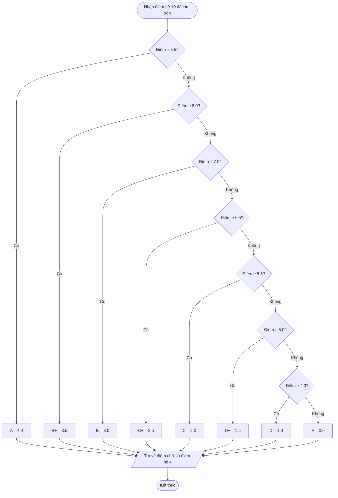

# F2 – Quy đổi điểm

Nguồn: PRD §2 F2. Phụ thuộc: F1. Được gọi bởi: F1, F4 (sau khi lưu), F3 (khi tính GPA hệ 4), hiển thị bảng.

Đầu vào: điểm hệ 10 **đã làm tròn 1 chữ số thập phân** (từ F1). Đầu ra: điểm chữ và điểm hệ 4.

## Ghi chú thiết kế
- **Dùng ngưỡng dưới (≥)** thay vì so khoảng `8.0 – 8.4`. Vì điểm đã làm tròn 1 chữ số, hai cách cho cùng kết quả, nhưng dùng ngưỡng thì không có "khe hở" (vd 8.45) nếu sau này đổi cách làm tròn.
- Là **hàm thuần** (không đọc/ghi DOM hay localStorage), nên dễ viết unit test cho từng ngưỡng biên: 0, 3.9, 4.0, 4.9, 5.0, 5.4, 5.5, 6.4, 6.5, 6.9, 7.0, 7.9, 8.0, 8.4, 8.5, 10.
- Điểm chữ và hệ 4 **không lưu vào localStorage**; luôn tính lại từ điểm hệ 10 khi cần (tránh dữ liệu lệch nhau).
