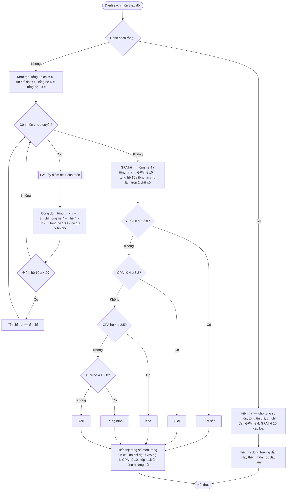

# F3 – Tính GPA và xếp loại

Nguồn: PRD §2 F3. Phụ thuộc: F2. Được gọi mỗi khi danh sách môn thay đổi: thêm (F1), sửa/xoá (F4), tải trang, xoá tất cả (F5).

## Ghi chú thiết kế
- **Tín chỉ đạt** = tổng tín chỉ các môn có điểm hệ 10 ≥ 4.0 (tức không phải F).
- **GPA tính trên tất cả môn**, kể cả môn F (PRD: Σ trên toàn bộ danh sách).
- **Xếp loại dựa trên GPA hệ 4 đã làm tròn 2 chữ số**, tức đúng con số người dùng nhìn thấy, tránh trường hợp hiển thị 3.60 mà xếp loại "Giỏi".
- Hiển thị GPA luôn đủ 2 chữ số thập phân (vd `3.50`, không phải `3.5`).
- Tách phần **tính toán** (hàm thuần nhận danh sách, trả về số liệu) khỏi phần **hiển thị** (cập nhật DOM) để unit test được phần tính toán.
- Tổng tín chỉ luôn > 0 khi danh sách không rỗng (tín chỉ ≥ 1 theo F1), nên không có chia cho 0.
