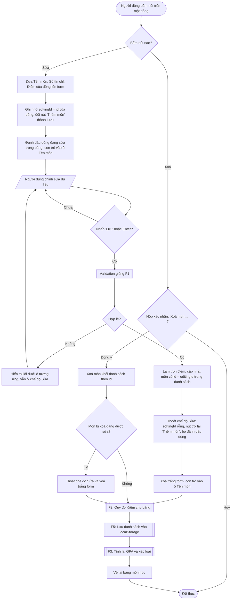

# F4 – Sửa và xoá môn học

Nguồn: PRD §2 F4. Phụ thuộc: F1 (dùng chung form và validation).

Mỗi dòng trong bảng có 2 nút: **Sửa** và **Xoá**. Trạng thái "đang sửa" được lưu bằng `editingId` (id của môn đang sửa, hoặc rỗng).

## Ghi chú thiết kế
- **Dùng chung một form** cho Thêm và Sửa; `editingId` quyết định khi submit sẽ thêm mới (F1) hay cập nhật (F4).
- **Bấm "Sửa" ở dòng khác khi đang sửa**: dữ liệu dòng mới ghi đè lên form, `editingId` chuyển sang dòng mới (thay đổi chưa lưu của dòng cũ bị bỏ).
- **Xoá đúng dòng đang sửa**: thoát chế độ Sửa để form không trỏ tới môn đã không còn.
- Hộp xác nhận xoá dùng `window.confirm` (đơn giản, có sẵn trên mọi trình duyệt), nội dung có tên môn để tránh xoá nhầm.
- Xoá theo **id**, không theo vị trí hay tên, nên an toàn khi trùng tên môn.

## Câu hỏi mở
- PRD không nhắc nút **"Huỷ"** khi đang sửa. Đề xuất: thêm nút "Huỷ" (hoặc phím Esc) để thoát chế độ Sửa mà không lưu. Cần người dùng xác nhận trước khi làm ở Stage 3.
