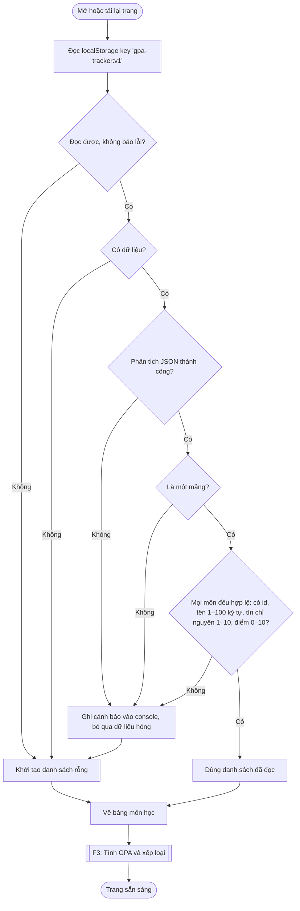
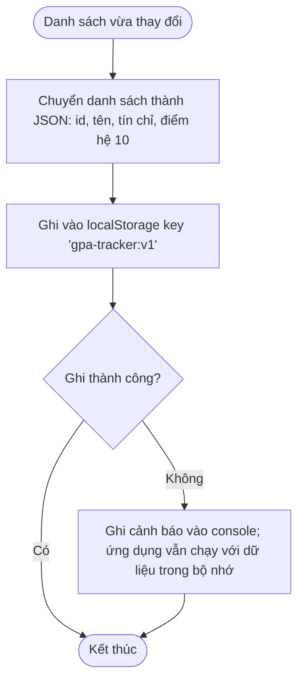
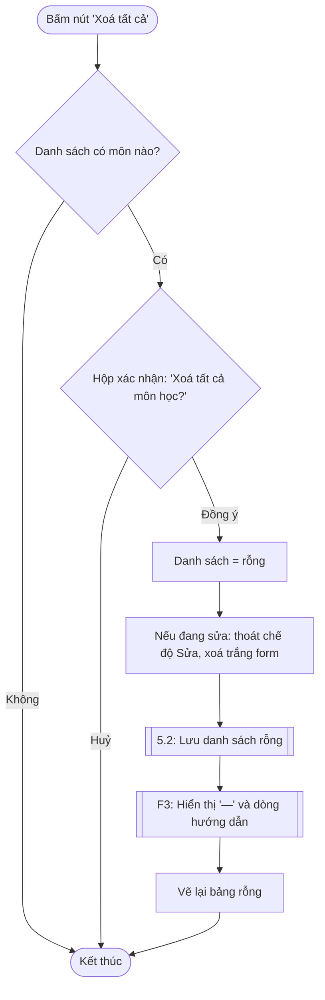

# F5 – Lưu dữ liệu

Nguồn: PRD §2 F5. Phụ thuộc: F1, F4.

Key localStorage: `gpa-tracker:v1`. F5 gồm 3 luồng: **tải khi mở trang**, **lưu khi có thay đổi**, và **xoá tất cả**.

## 5.1 Tải dữ liệu khi mở trang

## 5.2 Lưu khi danh sách thay đổi

Được gọi sau mỗi lần thêm (F1), sửa, xoá (F4), xoá tất cả (5.3).

## 5.3 Xoá tất cả

## Ghi chú thiết kế
- **Chỉ lưu dữ liệu gốc** (id, tên, tín chỉ, điểm hệ 10). Điểm chữ, hệ 4, GPA luôn tính lại (F2, F3).
- **Dữ liệu hỏng thì bỏ cả danh sách**, đúng PRD "bỏ qua, khởi tạo danh sách rỗng". Không cố cứu từng môn, vì làm vậy có thể ra GPA sai mà người dùng không biết.
- Mọi thao tác với localStorage nằm trong `try/catch`: trình duyệt chặn storage (chế độ riêng tư, hết dung lượng) không được làm trắng trang.
- Lỗi khi đọc/ghi chỉ ghi `console.warn`, không hiện thông báo cho người dùng (PRD không yêu cầu).
- Nút "Xoá tất cả" khi danh sách rỗng: không hỏi xác nhận, không làm gì (có thể làm mờ nút).
